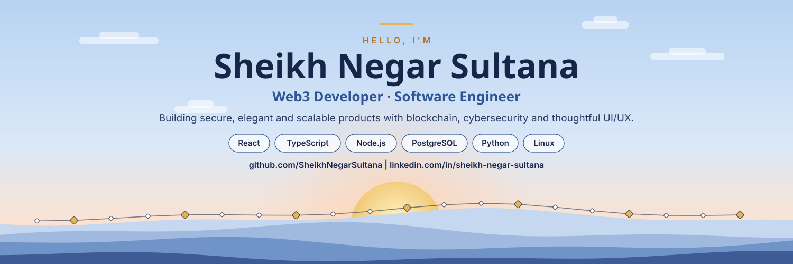

 

---

- 👋 Hi, I’m **@SheikhNegarSultana**
- 🎓 BSc in **Computer Science and Engineering** from Daffodil International University, from Dhaka, Bangladesh
- 🖥️ I’m currently working on **React.js, TypeScript and Tailwind CSS** for frontend development.
- 🗄️ Using **Node.js, Express.js, PostgreSQL and MariaDB** for the backend.
- 🛠️ I’m currently learning **AI-powered full-stack development, Web3 and blockchain basics, cybersecurity and Flutter**.
- 🔬 My research project **CellSeg-GNN-XAI** uses graph attention networks for explainable nucleus segmentation (Dice 0.727 on the PanNuke test split).
- 👥 I am the Lead Software Engineer of a five-person team building **Shusshadu**, a food-recipe website.
- 💬 Ask me about **Full-Stack (React, Node, Express, PostgreSQL), TypeScript, Python and deep-learning research**.
- 🌱 Beyond code, I enjoy psychology, design, journaling, art, food and travel writing.
- 🤝 Open to **remote software engineering roles, internships and research collaboration**.
- 📝 Find me on [LinkedIn](https://www.linkedin.com/in/sheikh-negar-sultana)
- 📫 Feel free to reach me out by [Email](mailto:sultanashashi.contact@gmail.com)

---

## 🛠️ Tech Stack

**Languages**
 

**Frontend**
 

**Backend and database**
 

**Tools and OS**
 

**AI / ML (from my research projects):** Python deep learning, graph neural networks, explainability

**Currently learning:** Web3 and blockchain basics, cybersecurity, Flutter, AI engineering tools

---

## 📊 GitHub Stats

<table>
  <tr>
    <td rowspan="2" width="34%" valign="top">
      
    </td>
    <td colspan="2" width="66%" valign="top">
      
    </td>
  </tr>
  <tr>
    <td colspan="2" valign="top">
      
    </td>
  </tr>
  <tr>
    <td colspan="3" valign="top">
      
    </td>
  </tr>
</table>

---

## 📌 Featured Projects

  
  

  
  

---

Open to collaboration, feedback and good conversations about Web3 and research.

